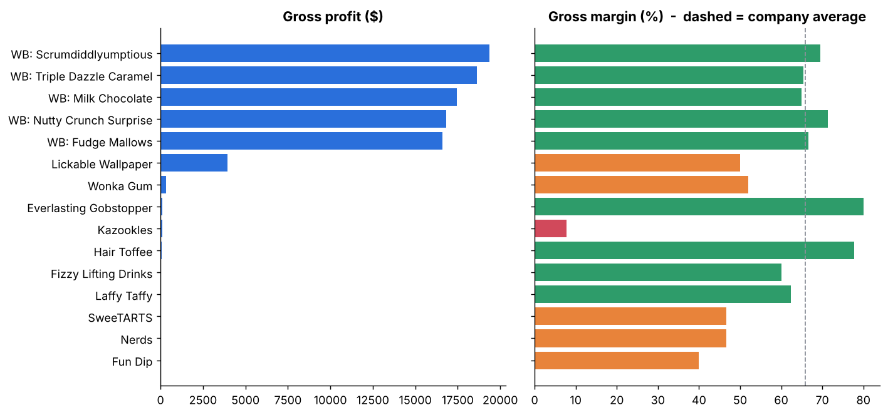
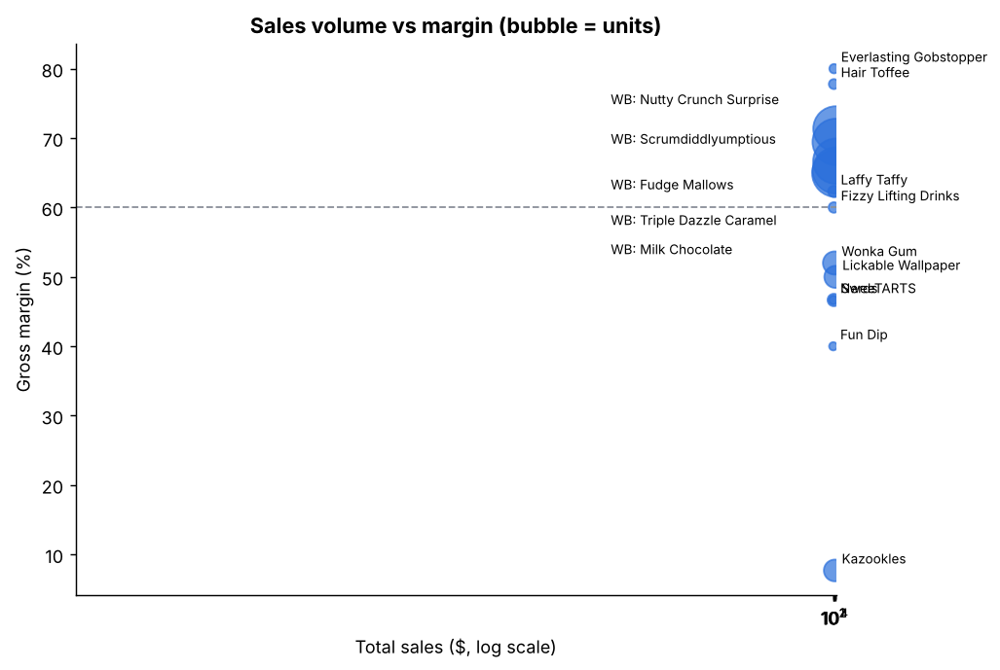
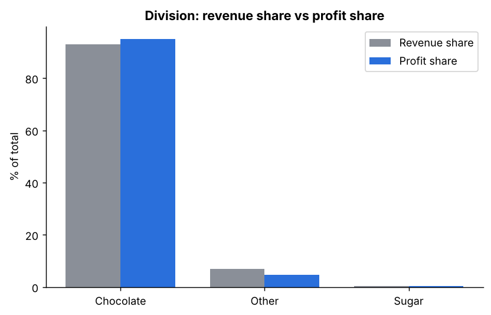
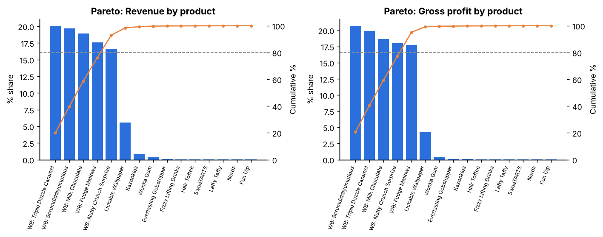
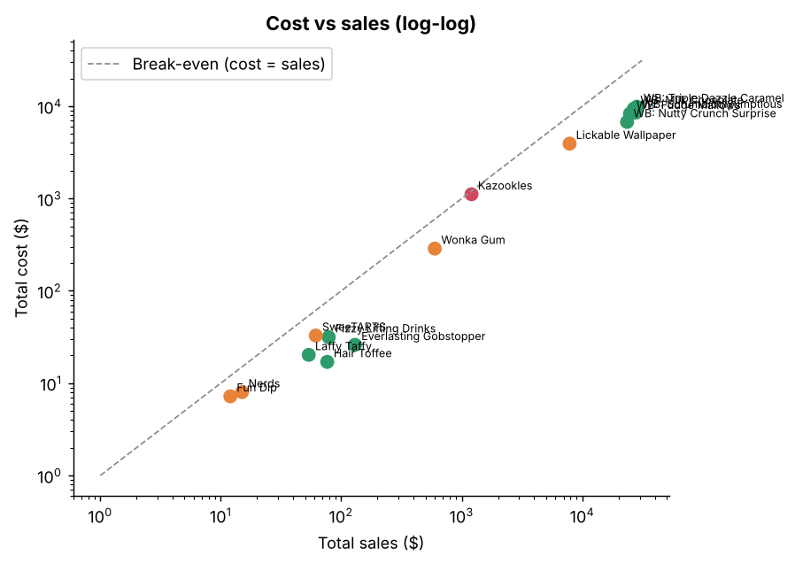
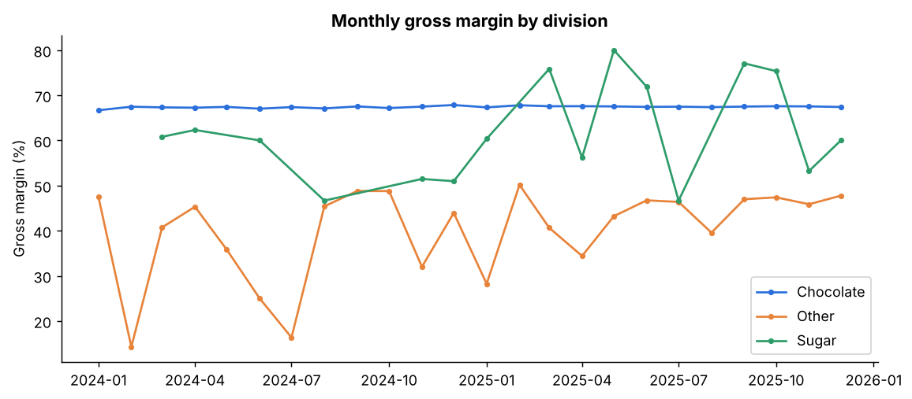

# Product Line Profitability & Margin Performance Analysis
### Nassau Candy Distributor, orders from 2 Jan 2024 to 31 Dec 2025

## Abstract

Nassau Candy sold **$141,784** of product over 2024-25 and earned **$93,443** gross profit (**65.9%** margin) across 10,194 order lines, 8,549 orders and 15 products. This study asks which products truly drive profit, whether high-sales products are profitable, how profitability differs by division, and where margin risk sits.

Main findings:

1. **Profit is concentrated in five chocolate bars.** They generate 92.9% of revenue and 95.1% of gross profit; five of 15 products are enough to reach 80% of both revenue and profit.
2. **High volume is not always high profit.** Lickable Wallpaper brings in 5.5% of revenue but only 4.2% of profit (50% margin), and Kazookles sells 371 units at a 7.7% margin ($0.25 profit per unit).
3. **The "Other" division is the structural margin problem:** 6.8% of revenue, 4.6% of profit, 44.8% margin versus 67.4% for Chocolate.
4. **Margin risk is structural, not volatile.** Every product sells at one price and one unit cost, so product margins never move. Fixing a weak margin is a pricing or sourcing decision.
5. **Total upside from fixing flagged products to a 60% margin is modest (about $1,477 over the two years, 1.6% of profit).** The bigger lever is pricing inside the chocolate range, where Milk Chocolate is the top-volume bar but earns the least profit per unit.

## 1. Business problem

For a distributor, sales volume alone is a misleading success measure. Some products sell heavily yet earn little, consume disproportionate manufacturing cost, and dilute the overall margin. Management lacks visibility into (a) which product lines deliver the highest gross margin, (b) whether high-sales products are actually profitable, (c) how profitability varies by division, and (d) which products carry margin risk.

## 2. Data

| Item | Value |
|---|---|
| Source | `Nassau Candy Distributor.csv` (10,194 rows x 18 columns) |
| Period | 2 Jan 2024 - 31 Dec 2025 (order dates) |
| Geography | 59 states/provinces (9,994 US rows, 200 Canada rows), 4 regions |
| Products / divisions / factories | 15 / 3 (Chocolate, Sugar, Other) / 5 |
| Factory mapping | Product-to-factory table supplied with the brief |

**Cleaning and validation** (`nassau/data.py`). The brief's rules were implemented as code and every rule is reported:

| Rule | Rows affected |
|---|---|
| Invalid (non-positive / missing) Sales or Cost | 0 |
| Gross Profit not equal to Sales - Cost | 0 |
| Missing / non-positive Units (would be imputed from median unit price) | 0 |
| Unparseable order dates | 0 |
| Product labels standardised (e.g. `Wonka Bar -Scrumdiddlyumptious` to `Wonka Bar - Scrumdiddlyumptious`) | applied to all rows |

No rows were removed; the dataset is internally consistent. **One data issue was found:** Ship Date values fall between 2026 and 2030, years after the 2024-25 order dates. Shipping timing was therefore not used. Profitability uses only Sales, Cost, Gross Profit, Units and Order Date, so it is unaffected.

**Another structural property:** each product has exactly one unit price and one unit cost across all 10,194 rows (no discounts, no price changes). This shapes the interpretation of "margin volatility" (Section 4.6).

## 3. Method

* **Gross margin** = gross profit / sales, computed on summed values (never an average of order-level ratios). **Profit per unit** = gross profit / units. **Revenue / profit contribution** = share of company totals.
* **Segmentation:** each product is classed by revenue share (high sales = at least 1% of revenue) and gross margin (healthy = at least 60%): *Star*, *Volume trap*, *Niche high-margin*, or *Low sales / low profit*. Both cut-offs are adjustable in the dashboard.
* **Risk flags:** margin below 25% is *critical*; 25-60% is *weak*. Combined with materiality these give *Discontinuation review*, *Cost renegotiation + repricing*, *Cost renegotiation*, *Repricing review*, or *Healthy*. For each flagged product the price or cost change needed to reach the target margin is calculated.
* **Concentration:** Pareto curves (products, states, regions) and the Herfindahl-Hirschman index (HHI) on profit shares for products, divisions, factories, states and regions.
* **Margin volatility:** standard deviation, in percentage points, of monthly margin.

## 4. Results

### 4.1 Product profitability



| Product | Sales | Gross profit | Margin | Profit / unit | Revenue share | Profit share |
|---|---:|---:|---:|---:|---:|---:|
| WB Scrumdiddlyumptious | $27,875 | $19,358 | 69.4% | $2.50 | 19.7% | 20.7% |
| WB Triple Dazzle Caramel | $28,485 | $18,610 | 65.3% | $2.45 | 20.1% | 19.9% |
| WB Milk Chocolate | $26,868 | $17,443 | 64.9% | $2.11 | 18.9% | 18.7% |
| WB Nutty Crunch Surprise | $23,575 | $16,820 | 71.3% | $2.49 | 16.6% | 18.0% |
| WB Fudge Mallows | $24,890 | $16,594 | 66.7% | $2.40 | 17.6% | 17.8% |
| Lickable Wallpaper | $7,860 | $3,930 | 50.0% | $10.00 | 5.5% | 4.2% |
| Wonka Gum | $598 | $311 | 52.0% | $0.65 | 0.4% | 0.3% |
| Kazookles | $1,206 | $93 | 7.7% | $0.25 | 0.9% | 0.1% |
| *Nine smaller products* | under $140 each | | 40-80% | | under 0.1% each | |

(WB = Wonka Bar. Full table: `outputs/tables/product_metrics.csv`.)

* **High-profit / high-margin:** all five Wonka Bars (65-71% margin). Nutty Crunch Surprise has the best margin (71.3%) because it has the lowest unit cost ($1.00).
* **High-sales / low-margin:** Lickable Wallpaper (50%). It is not unprofitable, since it earns $10 per unit, the most per unit among material products, but it drags the blended margin down.
* **Low-sales / low-profit:** Kazookles (7.7%), Wonka Gum (52%), SweeTARTS, Nerds and Fun Dip (40-47%).



### 4.2 Pricing inside the chocolate range

Milk Chocolate is the **highest-volume** product (8,267 units) but earns the **lowest profit per unit of any bar ($2.11)** because it is priced at $3.25 against $3.49-$3.75 for its peers. Triple Dazzle Caramel carries the highest unit cost ($1.30). Illustrative sensitivities on the full 2024-25 volume, holding volume constant (no price-elasticity data exists in this dataset, so these are upper bounds). All dollar upsides in this report are totals over the two-year period, not annual figures:

* Moving Milk Chocolate to $3.49 (the Nutty Crunch price) would add roughly **$1,984** gross profit (+2.1%).
* Each $0.10 cut in Triple Dazzle Caramel unit cost would add roughly **$760**.

### 4.3 Division performance



| Division | Products | Sales | Gross profit | Weighted margin | Avg order margin | Revenue share | Profit share |
|---|---:|---:|---:|---:|---:|---:|---:|
| Chocolate | 5 | $131,693 | $88,825 | 67.4% | 67.5% | 92.9% | 95.1% |
| Other | 3 | $9,663 | $4,333 | 44.8% | 37.7% | 6.8% | 4.6% |
| Sugar | 7 | $427 | $285 | 66.6% | 57.7% | 0.3% | 0.3% |

* **Chocolate** is strongly efficient: it earns 2.2 points more profit share than revenue share.
* **Other** has a structural margin issue (revenue share exceeds profit share by 2.2 points). Excluding Kazookles its margin is still only about 50%, so the issue is broader than one product.
* **Sugar** looks efficient (66.6%) but is only 40 orders and 0.3% of revenue. Its blended margin hides a 40-80% product range, and the sample is too small for firm conclusions.

By factory: Lot's O' Nuts 69.1%, Wicked Choccy's 65.1%, Sugar Shack 54.9%, Secret Factory 50.6%, **The Other Factory 11.9%** (driven by Kazookles).

### 4.4 Profit concentration (Pareto)



| Concentration test | Result |
|---|---|
| Products for 80% of revenue | 5 of 15 (33%) |
| Products for 80% of profit | 5 of 15 (33%) |
| States/provinces for 80% of profit | 16 of 59 (27%) |

| Dimension | Top item | Top-item profit share | Effective contributors | Risk |
|---|---|---:|---:|---|
| Product | Scrumdiddlyumptious | 20.7% | 5.5 | Low |
| Division | Chocolate | 95.1% | 1.1 | **High** |
| Factory | Lot's O' Nuts | 56.5% | 2.1 | **High** |
| State | California | 19.8% | 13.1 | Low |
| Region | Pacific | 32.6% | 3.8 | Moderate |

No single product dominates, but the business depends heavily on **one division and two factories**: Lot's O' Nuts and Wicked Choccy's together make 95.1% of profit. Geographic risk is moderate: California (19.8%), New York (10.9%) and Texas (9.5%) lead. Regional margins are almost identical (65.5-66.4%), so geography does not drive margin differences.

### 4.5 Cost-structure diagnostics



Six of 15 products are flagged. Together they hold 6.9% of revenue and 4.7% of profit.

| Product | Flag | Margin | Price for 60% margin | Or unit-cost cut |
|---|---|---:|---:|---:|
| Kazookles | Discontinuation review | 7.7% | $7.50 (+131%) | -57% |
| Lickable Wallpaper | Cost renegotiation | 50.0% | $25.00 (+25%) | -20% |
| Wonka Gum | Repricing review | 52.0% | $1.50 (+20%) | -17% |
| SweeTARTS | Repricing review | 46.7% | $2.00 (+33%) | -25% |
| Nerds | Repricing review | 46.7% | $2.00 (+33%) | -25% |
| Fun Dip | Repricing review | 40.0% | $2.25 (+50%) | -33% |

Kazookles shows the clearest problem. It sells at $3.25 against a $3.00 unit cost. A 60% margin would require more than doubling the price, which is unrealistic. Even a 25% margin needs a price of $4.00 (+23%). That is why it is flagged for **discontinuation review** rather than repricing. Bringing all flagged products to exactly 60% would add about **$1,477** (1.6% of profit).

### 4.6 Margin volatility

Because each product has one price and one cost, product-level margin volatility is 0.0 pp throughout; margin risk here is *structural*, not *erratic*. Company-level monthly margin varies only 0.5 pp (64.5%-66.7%), caused by product mix. Division-level volatility is 0.24 pp for Chocolate but about 10-11 pp for Other and Sugar; this reflects sparse monthly orders and mix, not unstable pricing.



### 4.7 Growth and seasonality

Sales rose 44.6% from 2024 to 2025 and gross profit 44.9%, with margin flat (65.8% to 66.0%). Growth is volume-driven. Q4 contributes 38% of annual sales, so seasonal peaks matter for cash and capacity planning.

## 5. Recommendations

| # | Action | Evidence | Expected effect |
|---|---|---|---|
| 1 | **Review Kazookles for discontinuation** (or re-source and reprice it); review The Other Factory's cost base | 7.7% margin, $0.25 profit/unit, 371 units | Removes a near-zero-profit line using 0.9% of revenue |
| 2 | **Renegotiate cost or raise price on Lickable Wallpaper** | 50% margin on 5.5% of revenue; +25% price or -20% cost reaches 60% | About +$786 at constant volume |
| 3 | **Test a Milk Chocolate price increase** toward $3.49 | Highest volume, lowest profit/unit among bars | Up to about +$1,984 (needs elasticity test) |
| 4 | **Negotiate Triple Dazzle Caramel input costs** | Highest unit cost ($1.30) among bars | About +$760 per $0.10 saved |
| 5 | **Reprice or prune minor Sugar/Other SKUs** (Wonka Gum, SweeTARTS, Nerds, Fun Dip) | 40-52% margins, under 0.5% of revenue combined | Small; mostly a simplification gain |
| 6 | **Reduce dependency risk:** secure supply at Lot's O' Nuts and Wicked Choccy's; develop growth in other divisions | 95% of profit from Chocolate | Resilience rather than margin |

Items 3 and 4 are worth more than fixing every flagged product combined, because they sit on the products that carry the business.

## 6. Limitations

* **No price history or discounts:** the single price and cost per product prevents elasticity, discount or cost-trend analysis. All "what-if" figures assume constant volume.
* **Gross profit only:** shipping, handling and overhead are excluded, so true net profitability is lower.
* **Small samples:** the Sugar division and the minor products have between 3 and 40 orders; conclusions about them are indicative only.
* **Ship Date quality:** shipping dates are inconsistent with order dates (2026-2030), so no logistics or lead-time analysis was attempted.
* **Two years of history:** seasonality and trend estimates rest on 24 months.

## 7. Reproducibility

```bash
pip install -r requirements.txt
python run_analysis.py          # tables -> outputs/tables, figures -> outputs/figures
pytest                          # 8 tests
streamlit run app.py            # interactive dashboard
```
